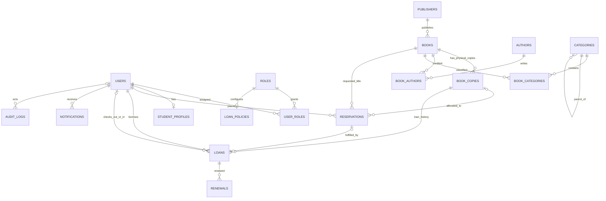

# School library database design

## Scope and assumptions

This schema is the relational foundation for a single school library. It supports administrator, librarian, and student accounts; title/edition cataloging; multiple physical copies per title; circulation, returns, renewals, title-level reservations, notifications, and audit history. It does not model fines/payments, multiple branches, class-year history, or external identity providers because those requirements were not specified.

A `books` row is one cataloged title/edition. Every physical item receives its own `book_copies` row and unique barcode. Availability is derived; there is no stored `available` flag or copy count that can drift from circulation data.

Target the database server to **MySQL 8.0.16+ or MariaDB 10.4+**, with InnoDB and `utf8mb4`. XAMPP on this machine includes MariaDB 10.4.32, which supports the generated-column indexes and enforced `CHECK` constraints used here. The minimum MySQL version ensures `CHECK` constraints are enforced. Use UTC for all `DATETIME` values; `DATETIME` itself carries no timezone. The SQL is laid out for phpMyAdmin import and includes only role and default student-loan-policy seed data. It creates no administrator account.

## Tables and data dictionary

All surrogate `id` values are `BIGINT UNSIGNED AUTO_INCREMENT`; foreign keys use the exact same type and sign. All text uses the database's `utf8mb4` character set. See [school_library.sql](schema/school_library.sql) for every column definition, index, and constraint.

| Table | Main columns and types | Purpose and key relationships |
|---|---|---|
| `roles` | `id BIGINT UNSIGNED`, `code VARCHAR(32)`, `name VARCHAR(80)`, `description VARCHAR(255)`, `created_at DATETIME` | Role catalog. `code` is unique. Referenced by `user_roles` and `loan_policies`. |
| `users` | `id BIGINT UNSIGNED`, `username VARCHAR(80)`, `email VARCHAR(254) NULL`, `password_hash VARCHAR(255)`, `first_name/last_name VARCHAR(100)`, `account_status ENUM`, timestamps | Login identity and shared person data. Username and non-null email are unique. Accounts are disabled/locked instead of deleted. |
| `user_roles` | `user_id, role_id BIGINT UNSIGNED`, `assigned_at DATETIME` | Many-to-many user-role mapping; composite PK prevents duplicate assignments. |
| `student_profiles` | `user_id BIGINT UNSIGNED`, `student_number VARCHAR(40)`, `grade_level VARCHAR(20)`, `section VARCHAR(50)`, timestamps | Student-only details, one-to-one with `users`; unique student number. |
| `loan_policies` | `id BIGINT UNSIGNED`, `borrower_role_id BIGINT UNSIGNED`, limits as `SMALLINT/TINYINT UNSIGNED`, `is_active TINYINT(1)`, timestamps | Configurable checkout period, active-loan, renewal, extension, and reservation limits per borrowing role. One policy per role. |
| `publishers` | `id BIGINT UNSIGNED`, `name VARCHAR(180)`, `created_at DATETIME` | Normalized publisher names, referenced optionally by `books`. |
| `authors` | `id BIGINT UNSIGNED`, `display_name VARCHAR(180)`, `created_at DATETIME` | Normalized author records, related to books through `book_authors`. |
| `categories` | `id BIGINT UNSIGNED`, `parent_category_id BIGINT UNSIGNED NULL`, `name VARCHAR(120)`, `description VARCHAR(500)`, `created_at DATETIME` | Subject taxonomy with optional parent category. A book may have several categories. |
| `books` | `id BIGINT UNSIGNED`, `isbn VARCHAR(20) NULL`, title/subtitle `VARCHAR(255)`, edition `VARCHAR(80)`, `publication_year SMALLINT UNSIGNED`, `language_code VARCHAR(10)`, `publisher_id BIGINT UNSIGNED NULL`, `description TEXT`, timestamps | Catalog-level title/edition. Nullable ISBN supports books without one; unique ISBN prevents duplicate edition records where known. |
| `book_authors` | `book_id, author_id BIGINT UNSIGNED`, `author_order SMALLINT UNSIGNED` | Many-to-many title/author relation and display order. Composite PK prevents duplicate author links; unique `(book_id, author_order)` keeps order slots distinct. |
| `book_categories` | `book_id, category_id BIGINT UNSIGNED` | Many-to-many title/category relation; composite PK prevents duplicate assignments. |
| `book_copies` | `id BIGINT UNSIGNED`, `book_id BIGINT UNSIGNED`, `barcode VARCHAR(80)`, `copy_status ENUM`, `shelf_location VARCHAR(100)`, `acquired_at DATE`, `notes VARCHAR(1000)`, timestamps | Individually tracked physical copies. Barcode is unique; copy status records circulation condition/lifecycle, not availability. |
| `loans` | `id BIGINT UNSIGNED`, `copy_id/borrower_user_id BIGINT UNSIGNED`, optional reservation/staff IDs, `checked_out_at/due_at/returned_at/lost_at DATETIME`, `status ENUM`, `return_condition ENUM`, notes | One checkout history row per copy loan. FKs retain copy and borrower history. A generated unique key permits at most one `ACTIVE` loan per physical copy. |
| `renewals` | `id BIGINT UNSIGNED`, `loan_id BIGINT UNSIGNED`, `renewal_number TINYINT UNSIGNED`, actor ID, `renewed_at/old_due_at/new_due_at DATETIME`, notes | Immutable renewal history, unique renewal sequence per loan. |
| `reservations` | `id/book_id/student_user_id BIGINT UNSIGNED`, nullable `allocated_copy_id`, `status ENUM`, request/ready/expiry/closed timestamps | Title-level queue request. A READY hold is assigned to one matching physical copy. Generated unique keys prevent duplicate active holds per student/title and two READY holds on one copy. |
| `notifications` | `id/user_id BIGINT UNSIGNED`, `notification_type VARCHAR(40)`, title/body, `created_at/read_at DATETIME` | In-app notifications for a user, indexed for listing and unread queries. |
| `audit_logs` | `id BIGINT UNSIGNED`, nullable actor and entity IDs, action/type strings, `old_values/new_values JSON`, IP/user-agent, `created_at DATETIME` | Append-only application audit events. `entity_id` is intentionally polymorphic, so `entity_type` identifies the target table and a direct FK is not possible. |

`created_at` and `updated_at` are stored on mutable records where they aid operations. Historical `loans`, `renewals`, and `audit_logs` should not be physically deleted. `updated_at` is not used to infer business events.

## Relationships and cardinality

The reservation-to-loan relationship is enforced from `loans` to `reservations`; `reservation_id` is nullable for direct checkout and unique for linked checkouts. A composite FK guarantees that a linked loan has the reservation's student as its borrower. The backend transaction must additionally ensure the checked-out copy belongs to the reservation's book.

## Circulation rules and data integrity

- **Availability:** a copy can be checked out only when its `copy_status='IN_SERVICE'`, there is no `ACTIVE` loan for it, and there is no `READY` reservation allocated to it. Compute this in the query/workflow; do not persist a second availability flag.
- **Duplicate checkout protection:** `loans.active_copy_id` is generated as `copy_id` only for ACTIVE rows and NULL otherwise, with a unique index. MySQL/MariaDB unique indexes permit multiple NULL values. The database rejects a second active loan for that copy even if two requests race.
- **Overdue:** derive it using `status='ACTIVE' AND due_at < UTC_TIMESTAMP()` (or a UTC timestamp supplied by the application). Do not store an `OVERDUE` status that can become stale overnight.
- **Copy lifecycle:** use `IN_SERVICE`, `DAMAGED`, `LOST`, or `WITHDRAWN`. On a damaged return, close the loan and set the copy to DAMAGED in the same transaction; staff later reclassify it to IN_SERVICE after repair. For a lost item, close the loan as LOST, set `lost_at`, and mark the copy LOST. If later recovered, record the transition in the audit log and close the recovery as a returned loan with a condition, clearing the `lost_at` marker.
- **Return:** update the loan to RETURNED with return time, receiving staff, and condition; update copy status; assign the copy to the earliest eligible pending reservation if the policy requires a hold. All writes happen in one transaction.
- **Renewal:** lock the active loan row, enforce policy renewal count, reject overdue loans and renewals when a waiting reservation exists, insert a `renewals` row, and update `loans.due_at` atomically. The unique `(loan_id, renewal_number)` prevents duplicated sequence values.
- **Reservation queue:** order eligible PENDING requests by `(requested_at, id)`. READY rows must have matching `allocated_copy_id`, `ready_at`, and `expires_at`; the composite FK verifies the assigned copy belongs to that title. On fulfillment, insert the linked loan, transition the reservation to FULFILLED, clear its copy allocation, and commit together.
- **Policy enforcement:** the seeded STUDENT policy is a starting default (14 days, at most 3 active loans, 1 renewal of 7 days, at most 3 reservations). These are not universal school rules. The backend must select one effective borrowing role for each checkout (for example, STUDENT for a user who also has LIBRARIAN access) and enforce its policy. Concurrent checkouts should serialize on a borrower row or other stable lock target before counting active loans.
- **Role/profile consistency:** FKs guarantee that referenced users and roles exist, but ordinary relational constraints cannot ensure that every STUDENT role has exactly one student profile. Enforce that invariant during account provisioning in one transaction.

`CHECK` constraints validate policy limits, loan timestamp/status combinations, reservation state fields, and positive due intervals. Cross-row rules such as copy status matching an active loan cannot be expressed as a portable row-level constraint here; enforce them transactionally in the backend. Avoid triggers for circulation state unless there is a clear need to duplicate application workflow inside the database.

## Foreign-key and deletion policy

- IDs and matching FKs are all `BIGINT UNSIGNED`; relationship tables use matching type/sign on both sides.
- Catalog, copy, borrower, loan, renewal, and reservation references use `RESTRICT` to preserve history and prevent deleting referenced records.
- Publisher deletion sets `books.publisher_id` to NULL. Deleting a user cascades only to role assignments, student profile, and notifications; loans/reservations restrict user deletion. Normal account removal is a status change, not a DELETE.
- Deleting a book cascades its author/category join rows, but is restricted while physical copies or reservations exist. Remove or withdraw copies through status instead of deleting them.
- Staff attribution FKs use `SET NULL` so deactivated/removed staff do not erase circulation history. Audit actor is likewise nullable; the audit event remains.

## TypeScript/mysql2 connection plan (no backend code yet)

Use `mysql2/promise` and a single bounded connection pool configured from environment variables (`DB_HOST`, `DB_PORT`, `DB_USER`, `DB_PASSWORD`, `DB_NAME`), with TLS enabled when the DB is remote. Set the session timezone to `+00:00` and configure consistent date handling. Keep credentials out of source control and never use the XAMPP root account for a deployed app: create a dedicated database user with only the required DML permissions. Use parameterized placeholders for values, never string-concatenate user input into SQL. Use `pool.getConnection()`, `beginTransaction()`, `commit()`, and `rollback()` around checkout, return, renewal, reservation allocation, and linked notification/audit writes; release the connection in `finally`. Set connection/acquire limits and timeouts, and avoid exposing SQL errors or credentials to clients.

## Security and backup guidance

- Hash passwords in the backend with Argon2id or bcrypt; store only the encoded hash in `password_hash`. Do not seed a default administrator password.
- Grant the app database account only table-level `SELECT`, `INSERT`, and `UPDATE` permissions it needs; deny `UPDATE`/`DELETE` on `audit_logs` and avoid application `DELETE` privileges. Schema changes belong to a separate admin account.
- Keep secrets in an ignored `.env` file locally and a secrets manager/environment configuration in deployment. Use HTTPS, rate-limit login, and audit privileged account/role and circulation changes.
- Restrict phpMyAdmin and XAMPP to local development; do not expose the XAMPP stack or phpMyAdmin publicly.
- Back up with a consistent database dump (for a small school library, scheduled `mysqldump`/`mariadb-dump` plus encrypted off-machine copies is suitable). Keep multiple retention points, protect backups with least-privilege access, and periodically test restore into a separate database. A backup is not verified until restore succeeds.
- Avoid logging password hashes, credentials, tokens, or unnecessary student personal information. Define retention limits for audit and notification records.

## Design review and validation status

- Catalog title and copy are separate; ISBN is nullable/unique; barcodes are unique.
- Every FK column matches its referenced BIGINT UNSIGNED type. All FK parent keys are primary or explicit unique keys; child lookup indexes are defined.
- Active copy loan and duplicate active student/title reservation guards are database-enforced with stored generated columns and unique indexes.
- Reservations cannot allocate a copy belonging to another title; reservation-linked loans cannot name a different student.
- Status enums and row-level CHECK constraints cover defined state combinations; cross-row state transitions are assigned to backend transactions.
- No plaintext password, default admin account, stored availability count, or stored overdue flag is included.
- The script was reviewed for dependency order and MySQL/MariaDB syntax against the stated minimum versions. XAMPP's MariaDB service is not starting yet, so this script has not been executed against a live server; after resolving the port conflict, import it first into a disposable XAMPP database and inspect `SHOW CREATE TABLE`/foreign-key metadata before production use.
